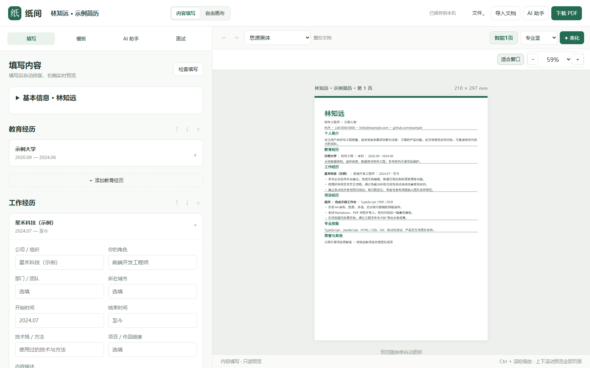
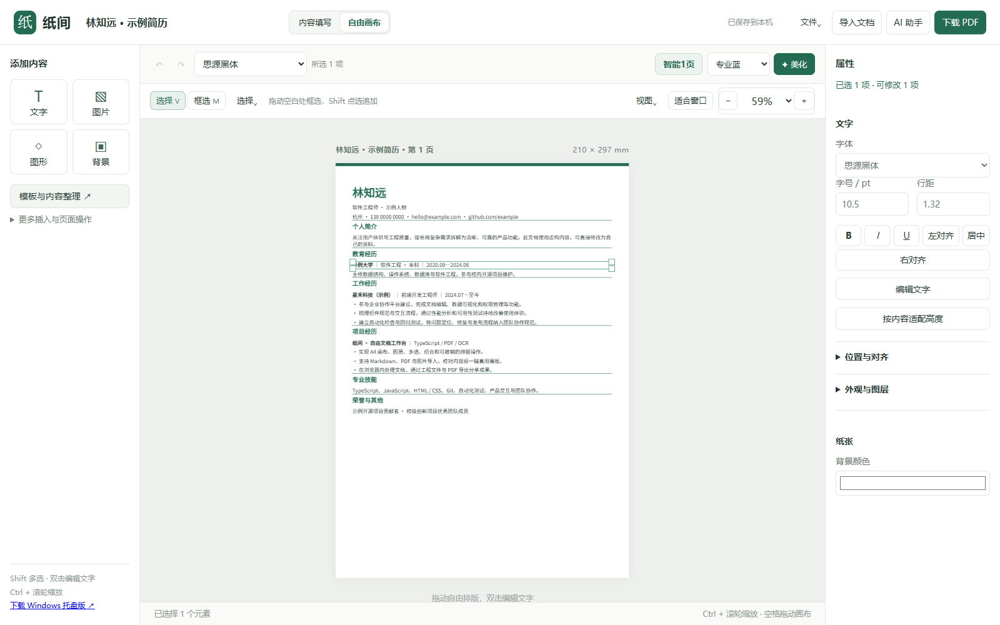

<div align="center">


# 纸间

**可填写、可排版的 A4 文档编辑器**

从简历开始，支持通知、求职信与项目介绍。模块填写与自由画布随时切换。

[](https://h0ll0w-akuzr0guy.github.io/zhijian/)
[](https://github.com/h0ll0w-AkuZr0guY/zhijian/releases/latest)
[](https://github.com/h0ll0w-AkuZr0guY/zhijian/actions/workflows/pages.yml)
[](LICENSE)

[开始使用](#开始使用) · [功能与界面](#功能与界面) · [使用说明](docs/USAGE.md) · [参与贡献](docs/CONTRIBUTING.md) · [发布记录](docs/RELEASES.md)

</div>



纸间将内容填写、模板排版和元素编辑放进同一份工程。先用表单组织经历、预览版式，再进入自由画布调整文字、图片和图形。学校、专业与日期可以通过虚拟横向基线绑定，移动锚点时整行跟随。多页文档连续展示，向下滚动即可浏览。

PDF、Markdown 和图片在本机提取或识别，编辑后可下载 PDF、PNG、Markdown 与工程文件。AI 使用你配置的模型接口和 API Key，提供条目内起草、润色、重点加粗、划选改写和侧栏模拟面试。

## 开始使用

### 在线编辑

1. 打开 [在线版](https://h0ll0w-akuzr0guy.github.io/zhijian/)，可以直接修改虚构示例，或从「文件」新建空白文档。
2. 点击「导入文档」选择 PDF、Markdown 或图片，校对识别结果，选择保留位置或模板重排。
3. 顶部选择「内容填写」，完善基本信息、教育与经历等模块，右侧预览会随填写更新。「模板」侧栏可更换版式和固定为1页。
4. 需要细调时切换「自由画布」，拖动元素、批量修改或绑定同行字段。
5. 点击「下载 PDF」交付文件，通过「文件 → 保存工程」下载 `.zhijian`，便于备份和继续编辑。

首次切换填写模式保留当前画布排版。修改表单或选择模板后，文字按模板重新排版，支持撤销。图形与额外图片会保留。详细操作见 [使用说明](docs/USAGE.md)。

### Windows 桌面版

从 [Releases](https://github.com/h0ll0w-AkuZr0guY/zhijian/releases/latest) 下载 `zhijian_<版本>_x64-setup.exe` 并安装，安装包包含编辑界面和 OCR 资源。运行环境使用 Windows WebView2。

关闭窗口会隐藏到托盘，托盘菜单支持重新打开、查看识别进度、取消识别和退出。网页与桌面版可用 `.zhijian` 工程交换内容，各自的本机文档库独立保存。

## 功能与界面

### 模块填写与自由画布

| 内容填写                              | 自由画布                                   |
| ------------------------------------- | ------------------------------------------ |
| 左侧模块表单，右侧只读预览            | 左侧插入工具，中间画布，右侧属性           |
| 已有简历预填，条目与模块增删、排序    | 文字、图片、线条和常用图形独立编辑         |
| 富文本、填写提纲、模块内 AI 建议替换  | 框选、多选批改、组合、对齐、等距分布与锁定 |
| 模板自动排版，支持连续多页与固定为1页 | 对齐吸附、虚拟基线、同行绑定与整体缩放     |



两种模式共用工程、自动保存和撤销记录。表单生成的文字在画布修改后会同步回字段，新增独立文字归入补充模块。再次通过表单排版时，文字位置由模板安排。

### 导入、整理与导出

- **本机识别**。PDF 文字与图片提取，扫描件和图片支持中英文 OCR，提供原稿对照和拖框截图。
- **段落编辑**。导入时合并文字碎片，保留学校、专业和日期等同行字段，也支持手动合并与拆分。
- **模板整理**。四种简历模板，以及通知、求职信、项目介绍模板。一键美化统一层级、配色与间距，智能1页提供比例和最小字号预览。
- **常用字体**。支持微软雅黑、宋体、黑体、楷体、Times New Roman、Arial、Georgia 与思源黑体。系统字体依赖本机安装情况。
- **多种交付**。PDF 保留可选择文字，PNG 输出当前可见页，Markdown 输出内容，`.zhijian` 保存可继续编辑的工程。

PDF 导入会恢复文字坐标、图片和可推断的内容层级。复杂多栏、特殊字体或扫描噪声仍需对照校正。智能1页通过合并空白和等比缩放适配，内容较多时请检查最终字号。操作细节见 [导入与排版说明](docs/USAGE.md)。

### 使用自己的 AI 模型

在「AI 助手 → 模型设置」填写 Base URL、模型名称和 API Key，支持 Chat Completions 兼容接口。

- 描述为空时根据已填背景起草提纲，未知信息使用待补充占位符。
- 在经历条目内润色、加粗或改写划选文字，校对后单段替换或批量采用。
- 在侧栏按目标岗位进行多轮模拟面试，下载 Markdown 面试记录。

请求从浏览器直接发往所配置端点，需要服务支持浏览器跨域访问。配置、发送范围、密钥保存与常见错误见 [AI 与数据说明](docs/AI_AND_DATA.md)。

## 数据保存在何处

导入、识别、排版和导出在本机执行。文档库使用当前浏览器的 IndexedDB，浏览器缓存保存部分站点与识别资源，AI 设置使用浏览器存储。使用 AI 时，预览范围内的文字会发送到你配置的模型服务。

本机文档库按浏览器与站点地址隔离。更换浏览器、清理站点数据或使用隐私窗口会影响内容保留，请下载工程备份。工程包含文档、图片和填写数据，分享前应检查其中的个人资料。详见 [AI 与数据说明](docs/AI_AND_DATA.md)。

## 反馈与贡献

欢迎提交复现步骤、交互建议、模板改进与代码贡献。反馈中请附应用版本、浏览器或系统、操作步骤及脱敏截图。可用虚构文字制作最小复现工程。

[反馈问题](https://github.com/h0ll0w-AkuZr0guY/zhijian/issues/new/choose) · [贡献指南](docs/CONTRIBUTING.md) · [开发指南](docs/DEVELOPMENT.md)

## 文档导航

| 文档                                 | 内容                                                       |
| ------------------------------------ | ---------------------------------------------------------- |
| [使用说明](docs/USAGE.md)            | 两种模式、导入校对、模板、吸附绑定、快捷键、导出与常见问题 |
| [AI 与数据说明](docs/AI_AND_DATA.md) | 模型配置、AI 工作流、联网范围、存储与工程分享              |
| [开发指南](docs/DEVELOPMENT.md)      | 环境、代码结构、数据模型、测试、构建与发布                 |
| [贡献指南](docs/CONTRIBUTING.md)     | 问题反馈、PR、自测与示例资料要求                           |
| [发布记录](docs/RELEASES.md)         | 已发布版本与更新入口                                       |
| [第三方声明](THIRD_PARTY.md)         | 字体、OCR、PDF 与依赖许可                                  |

## 本地开发

使用 Node.js 22.13 或更新的受支持版本。

```sh
npm ci
npm run dev
```

开发页面为 `http://127.0.0.1:5173/`。提交前运行 `npm run check`、`npm test` 和 `npm run build`。桌面开发与静态部署见 [开发指南](docs/DEVELOPMENT.md)。

## 开源许可

应用代码采用 [MIT License](LICENSE)。字体、模型和运行时遵循各自许可，详见 [第三方声明](THIRD_PARTY.md)。界面截图来自项目自带的虚构简历。
